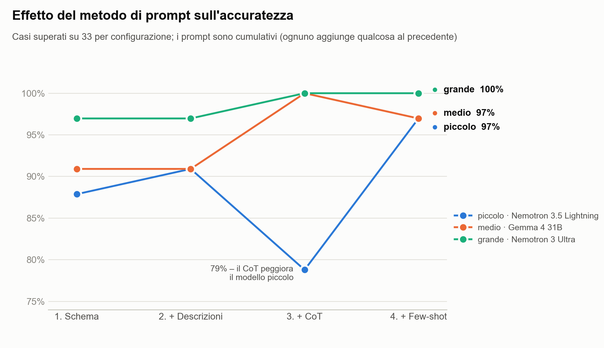
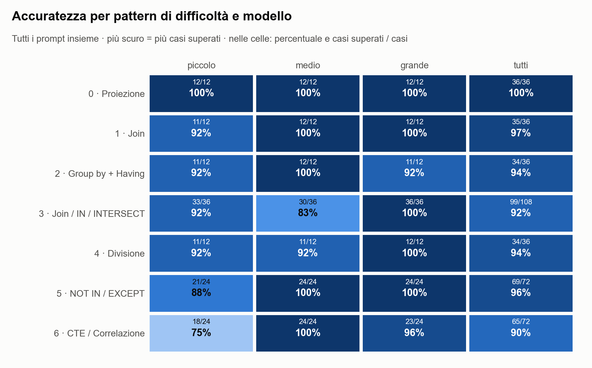
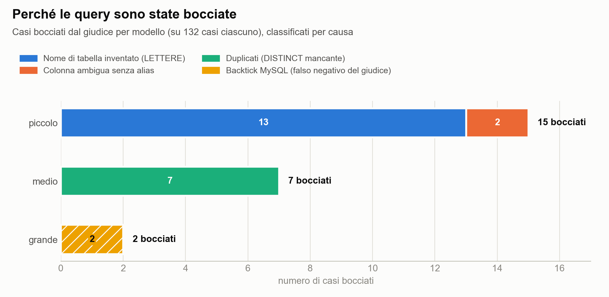

# Text2SQL con LLM sulla base di dati Biblioteca

Questo progetto nasce dall'esercitazione Text2SQL del Master in Intelligenza Artificiale del Politecnico di Torino. La domanda di partenza è semplice: se diamo a un modello linguistico lo schema della base dati *Biblioteca* e una domanda in italiano, quante volte scrive la query SQL giusta? E quanto pesa la dimensione del modello rispetto al modo in cui lo interroghiamo?

Il testo dell'esercitazione propone di fare le prove a mano, dalle interfacce web dei modelli. Abbiamo preferito automatizzare il lavoro. Uno script manda le domande ai modelli, esegue le query che ottiene su un piccolo database di prova e chiede a un altro modello, il giudice, se la risposta è corretta. In questo modo l'esperimento si rifà da capo con un comando e i risultati non dipendono da quanta pazienza si ha nel copiare e incollare.

```
x (domanda) ──► f (modello + prompt) ──► f(x) (SQL generato)
                                             │
y (SQL atteso) ──────────────────────────────┤
                                             ▼
                  esecuzione di f(x) e y sul database di prova (DuckDB)
                                             ▼
                  g = LLM giudice(x, y, f(x), risultati) ──► {esito 1/0, motivazione}
```

## Come è costruito l'esperimento

### Le domande

Lo schema *Biblioteca* è stato scritto apposta per il corso, quindi in rete non si trovano domande già pronte su queste tabelle. Siamo partiti da esercizi SQL pubblicati e li abbiamo adattati: gli esercizi risolti del corso di Basi di Dati del PoliTo, le soluzioni di un'esercitazione dell'Università di Bergamo, un tema d'esame dell'Università di Parma e il progetto *Library Management System* di w3resource. Per ogni domanda, `dataset/dataset.json` indica l'esercizio di partenza e che cosa abbiamo cambiato.

Le domande sono 21, tre per ciascuno dei sette pattern di difficoltà previsti dal testo, dalla semplice proiezione fino alle CTE e alle query correlate. Per i pattern 3, 5 e 6 il testo chiede di risolvere la stessa domanda con strategie diverse, per esempio con NOT IN e con EXCEPT. Abbiamo contato ogni strategia come un caso a sé, per un totale di 33 casi.

### Il database di prova

Per capire se una query è giusta bisogna eseguirla. Abbiamo creato un database DuckDB con dati inventati, ma scelti con un criterio preciso: prestiti non ancora restituiti, un lettore che non ha mai preso niente in prestito, due sale con la stessa capienza sullo stesso piano, autori di cui sono stati prestati solo alcuni libri. Sono le situazioni in cui una query sbagliata di solito si tradisce.

Prima di usare le soluzioni attese le abbiamo eseguite tutte. Per le domande con più strategie abbiamo controllato anche che le diverse soluzioni restituissero lo stesso risultato.

### I prompt

I prompt sono quattro e ognuno aggiunge qualcosa al precedente:

1. lo schema con le chiavi primarie, cioè il prompt d'esempio del testo;
2. in più, una descrizione di ogni tabella;
3. in più, un ragionamento guidato in sei passi (Chain-of-Thought);
4. in più, un esempio risolto per ogni pattern (few-shot).

Quando la domanda richiede una strategia precisa, il prompt aggiunge una riga come "Risolvi la query utilizzando l'operatore EXCEPT".

### I modelli e il giudice

Abbiamo usato tre modelli di dimensioni diverse, tutti tramite OpenRouter: Nemotron 3.5 Lightning di NVIDIA come modello piccolo, Gemma 4 31B di Google come medio e Nemotron 3 Ultra, da 550 miliardi di parametri, come grande. Il giudice è Gemini 3.1 Flash Lite, che non appartiene a nessuna delle due famiglie valutate. Non giudica soltanto leggendo le query: oltre alla domanda e alle due query riceve anche i risultati che entrambe producono sul database di prova.

Tre modelli, quattro prompt e 33 casi fanno 396 query, generate a temperatura 0 e giudicate una per una. L'esecuzione completa è durata una ventina di minuti ed è costata circa 20 centesimi di dollaro.

## I file prodotti

Il file [`deliverables/risultati_text2sql.xlsx`](deliverables/risultati_text2sql.xlsx) ha quattro fogli:

- *Risultati* contiene una riga per ogni query generata, con pattern, strategia, domanda, soluzione attesa, prompt usato, modello, SQL generato, esito e commento del giudice, e l'esito del confronto sul database di prova.
- *Griglia* riassume i successi totali e per pattern. I numeri sono formule `COUNTIFS` calcolate sul primo foglio, che Excel aggiorna all'apertura.
- *Grafici* raccoglie i grafici riportati più sotto.
- *Note* elenca i modelli usati e spiega le colonne.

La stessa griglia, con il dettaglio di ogni combinazione di modello e prompt, è in [`deliverables/griglia_valutazione.md`](deliverables/griglia_valutazione.md). I grafici in formato PNG sono in [`deliverables/grafici/`](deliverables/grafici/).

## Risultati



Con gli esempi few-shot tutti e tre i modelli arrivano almeno al 97%. Il ragionamento guidato porta medio e grande al 100%, ma fa scendere il piccolo al 79%.



Le proiezioni non hanno mai creato problemi. Le difficoltà si concentrano nei pattern con più soluzioni possibili: il 3 per il modello medio, il 5 e il 6 per quello piccolo.



Ogni modello sbaglia quasi sempre allo stesso modo. Le due bocciature del modello grande sono in realtà errori del giudice, come spieghiamo più avanti.

Gli stessi dati in tabella. Qui sotto i casi superati su 33 per ogni combinazione:

| Modello | 1 Schema | 2 + Descrizioni | 3 + CoT | 4 + Few-shot | Totale |
|---|---|---|---|---|---|
| piccolo (Nemotron 3.5 Lightning) | 29 (88%) | 30 (91%) | 26 (79%) | 32 (97%) | 117/132 (89%) |
| medio (Gemma 4 31B) | 30 (91%) | 30 (91%) | 33 (100%) | 32 (97%) | 125/132 (95%) |
| grande (Nemotron 3 Ultra) | 32 (97%) | 32 (97%) | 33 (100%) | 33 (100%) | 130/132 (98%) |
| Totale | 91/99 (92%) | 92/99 (93%) | 92/99 (93%) | 97/99 (98%) | 372/396 (94%) |

E i casi superati per pattern, sommando i quattro prompt:

| Modello | 0 Proiez. | 1 Join | 2 Group by | 3 Join/IN/INTERSECT | 4 Divisione | 5 NOT IN/EXCEPT | 6 CTE/Correl. |
|---|---|---|---|---|---|---|---|
| piccolo | 12/12 | 11/12 | 11/12 | 33/36 | 11/12 | 21/24 | 18/24 |
| medio | 12/12 | 12/12 | 12/12 | 30/36 | 11/12 | 24/24 | 24/24 |
| grande | 12/12 | 12/12 | 11/12 | 36/36 | 12/12 | 24/24 | 23/24 |
| Totale | 100% | 97% | 94% | 92% | 94% | 96% | 90% |

## Che cosa ci dicono i risultati

### La dimensione conta meno di quanto pensassimo

Su questo schema tutti i modelli superano l'88%, anche il più piccolo. Il modello grande non sbaglia mai: le uniche due bocciature dipendono dal giudice. Le differenze tra i modelli emergono quasi solo nei pattern con più strategie possibili, mentre le proiezioni sono risolte da tutti, con qualsiasi prompt.

### Ogni modello ha il suo errore tipico

Più che un pattern difficile per tutti, abbiamo trovato un errore ricorrente per ciascun modello.

Il modello piccolo, in 13 dei suoi 15 errori, inventa il nome della tabella: scrive `LETTERE` (o `LETTORI`) al posto di `LETTORE`, come se "correggesse" l'italiano dello schema. La logica della query spesso è giusta, ma la query non si può eseguire. Gli altri due errori sono colonne ambigue in un INTERSECT e in un EXCEPT, dove mancava l'alias della tabella. In un caso, poi, il modello ha ragionato così a lungo da esaurire gli 8.000 token a disposizione e la risposta si è interrotta a metà.

Gemma sbaglia sette volte, e sempre per lo stesso motivo: dimentica il DISTINCT e restituisce righe duplicate. Succede nei self-join e nelle query con IN del pattern 3, e in una divisione scritta con NOT EXISTS. È un errore insidioso, perché su questo database a volte il risultato coincide lo stesso: per accorgersene bisogna pensare a cosa succederebbe con dati diversi.

Il modello grande non commette errori di logica. In due casi usa i backtick di MySQL per i nomi delle colonne (`` `piano` ``), che DuckDB non accetta.

### L'effetto dei prompt

Aggiungere la descrizione delle tabelle cambia poco, appena un caso in più. Per domande di questo livello lo schema con le chiavi primarie basta già.

Il ragionamento guidato porta Gemma e Nemotron Ultra al 100%. Nel caso di Gemma l'effetto si spiega bene: uno dei sei passi chiede di controllare che la query restituisca esattamente le colonne richieste, e i DISTINCT mancanti spariscono. Sul modello piccolo succede il contrario. I ragionamenti diventano più lunghi, i nomi di tabella inventati aumentano (5 dei 13 vengono da questo prompt) e una risposta resta troncata.

Il few-shot è il prompt che funziona meglio, con il 98% complessivo, ed è anche quello che aiuta di più il modello piccolo, che arriva al 97%. Vedere i nomi delle tabelle scritti in query complete basta quasi a eliminare l'errore `LETTERE`. Va detto però che alcuni esempi hanno la stessa struttura di alcune domande del dataset, soprattutto nel pattern 6, quindi una parte del vantaggio è un aiuto diretto.

### Le strategie richieste vengono rispettate

Quando il prompt chiede una strategia precisa (JOIN, IN, INTERSECT, NOT IN, EXCEPT, CTE o sottoquery correlata), i modelli la usano sempre. L'unico caso segnalato come non rispettato è un errore del giudice.

### Ragionare di più non vuol dire rispondere meglio

Il modello piccolo produce in media tra 2.000 e 2.750 token per risposta: ragiona a lungo anche quando nessuno glielo chiede. Gemma ne usa tra 100 e 370, Nemotron Ultra tra 430 e 830. Il modello che scrive di più è anche quello che sbaglia di più.

### Quanto ci si può fidare del giudice

Il giudice è d'accordo con il confronto automatico dei risultati in 394 casi su 396. Per capire dove sbaglia abbiamo riletto a mano tutti i 24 casi bocciati e i 2 disaccordi.

Due bocciature sono sbagliate: si tratta delle due query del modello grande con i backtick (P2-3 con il prompt 2 e P6-2 in versione correlata con il prompt 1). Sostituendo i backtick con i doppi apici, le query restituiscono esattamente il risultato atteso. Il giudice le ha bocciate anche se le istruzioni gli chiedevano di non penalizzare le differenze di dialetto, e nel secondo caso ha anche sostenuto, a torto, che la query non fosse correlata. Correggendo questi due giudizi il modello grande arriva a 132 su 132 e il totale a 374 su 396 (94,4%).

In altri due casi il giudice arriva alla conclusione giusta per la ragione sbagliata. Sono le query di Gemma con IN nel pattern 3, con i prompt 1 e 2. La bocciatura è corretta, perché senza DISTINCT un lettore con più prestiti fantasy comparirebbe più volte, lo stesso criterio usato negli altri casi. La motivazione del giudice però descrive un errore di logica che non esiste.

I restanti 20 giudizi negativi sono corretti e le motivazioni indicano il problema vero: tabella inesistente, colonna ambigua, duplicati, risposta troncata.

Nei file prodotti abbiamo lasciato i giudizi così come li ha dati il giudice: le correzioni sono riportate solo in questo README.

## Limiti

Il dataset è piccolo: tre domande per pattern e 33 casi per configurazione, per cui un singolo caso vale circa tre punti percentuali. Molte differenze tra un prompt e l'altro sono di uno o due casi e vanno lette come tendenze, non come risultati definitivi. In più ogni configurazione è stata eseguita una sola volta, a temperatura 0, quindi non sappiamo quanto i risultati cambierebbero ripetendo le prove.

Le domande non sono prese parola per parola dalle fonti, perché nessuna fonte usa questo schema: sono adattamenti, verificati sul database di prova.

Rispetto al testo dell'esercitazione abbiamo cambiato i modelli: al posto di ChatGPT, Gemini e Codestral usati dal browser ci sono tre modelli chiamati via API e scelti in base alla dimensione. Gemma è nella versione a pagamento perché quella gratuita, servita solo tramite Google AI Studio, non era utilizzabile dal nostro account. Il costo è stato di pochi centesimi.

Il giudice, infine, è un modello economico. Funziona bene quasi sempre, ma inciampa sulle differenze di dialetto SQL. Un giudice più grande, oppure una normalizzazione del dialetto prima di eseguire le query, eliminerebbe i falsi negativi che abbiamo trovato.

## Rifare l'esperimento

```
prompts/        i 4 prompt (p1–p4), le istruzioni per le strategie, il prompt del giudice
dataset/        dataset.json (con la versione leggibile dataset.md) e validate.py
db/             build_db.py, che crea biblioteca.duckdb con schema e dati di prova
harness/        run.py (generazione e giudizio), report.py (file finali), charts.py (grafici), db_utils.py, llm.py, config.py
results/        risposte grezze dei modelli e del giudice (.jsonl) e log
deliverables/   Excel, griglia e grafici
```

```bash
python3 -m venv .venv && .venv/bin/pip install -r requirements.txt
echo 'API_KEY=<chiave OpenRouter>' > .env
.venv/bin/python dataset/validate.py      # crea il database e verifica il dataset
.venv/bin/python -m harness.run           # generazione e giudizio (se si interrompe, riprende da dove era arrivato)
.venv/bin/python -m harness.report        # Excel, griglia e grafici in deliverables/
```
